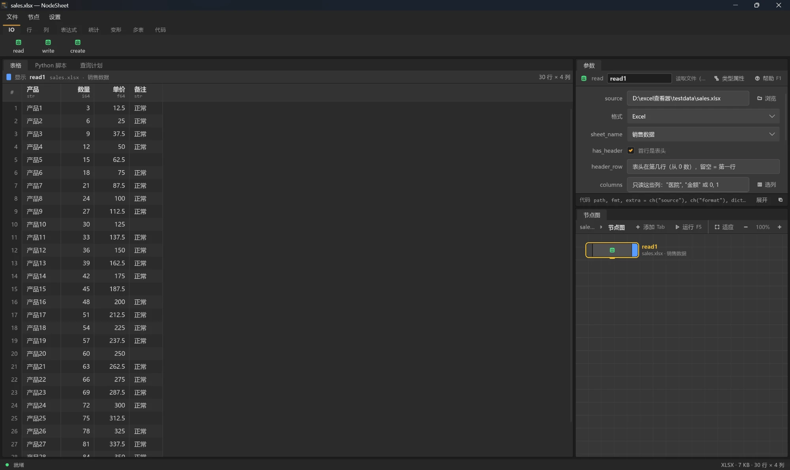

# NodeSheet

小巧、打开快的 Windows 桌面表格查看器（Rust + Slint）。先像普通查看器一样秒开大表；需要处理数据时，用右侧的**节点图**完成筛选、排序、分组、连接、写 polars 代码等操作——像 Houdini 一样，数据从节点流向节点。

数据处理由内置的 polars 引擎完成，**不需要另外安装 Python**。



## 特性

- **秒开大表**：xlsx/xlsm 流式渐进解码，前 1000 行立刻可见，后台继续解码，状态栏显示进度；100 万行的 xlsx 全量解码约 4 秒，CSV 毫秒级
- **格式全**：`xlsx / xlsm / xls / xlsb / ods`、`parquet`、`csv / tsv`、`json / ndjson`、`arrow / feather / ipc`、`avro`
- **节点图做数据操作**：两级节点（表格级传 DataFrame，表达式级像 Houdini 的 VOP 点进去连），命令照 polars 的方法命名，400 多种表达式节点由 polars 签名自动生成
- **类型推断**：每个节点头上写着它输出的列类型，连线按类型着色；出错一路标红到源头，不太对的地方黄色提醒
- **预览任何中间结果**：选中网络里的任一节点，表格显示它算出来的值；中键按住节点看行数、列数、用时
- **文字 ⇄ 节点**：表达式网络可以转成一行 polars 代码复制走，也可以把写好的表达式拆回节点
- **导出 Python 脚本**：整条节点链一键导出成能直接运行的 polars 脚本
- **工程文件**：节点图 + 界面布局存成 `.rtv`，下次直接打开；撤销 / 重做、改过没存提醒
- **表格好用**：Excel 式选择（拖选、Ctrl 加选不连续行列）、复制粘贴兼容 Excel、右键直接建排序 / 筛选 / 统计节点、GBD/GBK 等编码和分隔符自动识别
- **自定义节点**：一份 `.py` 文件就是一种新节点（像 Houdini 的数字资产），带参数界面编辑器和帮助文档
- **免安装、体积小**：整个文件夹放在任意位置即可，随包自带 Python + polars 运行时

## 下载使用

系统要求：Windows 10 / 11 64 位。

- 用打包脚本自行打包：

  ```powershell
  pwsh .\package.ps1     # 产出 dist\NodeSheet\ 文件夹和 zip
  ```

- 或从源码构建（见下文），运行 `target\release\nodesheet.exe`。

双击 `NodeSheet.exe` 运行，或把表格文件拖进窗口。`engine` 文件夹是节点功能用的 Python + polars 运行时，请和 exe 放在一起，不要删。

## 快速上手

1. 双击 exe，或把文件拖进窗口，或 `Ctrl+O` 打开。
2. 表格立刻显示；Excel 的 sheet 在 read 节点的 `sheet_name` 里切换。
3. 要处理数据：点顶部工具架或按 `Tab` 搜索添加节点，节点自动接在当前节点的下游，跑完表格跟着换。
4. 筛选、排序、分组、新增 / 改写列用 **expr** 节点：先在参数里选上下文（`with_columns / select / filter / group_by / sort`），再双击节点进到里面的表达式网络，节点从左往右连，最后连到输出节点上。按 `U` 回上一级。
5. `Ctrl+S` 把节点图存成 `.rtv` 工程。

## 界面

照 Houdini 的样子：菜单栏下是工具架（按分类的节点按钮，点一下接在选中节点下面），左边表格面板（表格 / Python 脚本 / 查询计划三个页签），右边上面参数面板、下面节点图画布，面板之间的缝可以拖动调大小，还能左右 / 上下互换布局。

- 文件名在窗口标题栏，文件信息和选区在状态栏
- 节点是一个窄条：右端蓝色旗标 = 表格显示这个节点的结果，左端黄色旗标 = 旁路（输入原样传下去）
- 画布：中键或空格 + 左键平移，滚轮缩放，`H` 看全部，`G` 看选中，`L` 自动排列

## 节点图

### 基本概念

每个节点把输入的 DataFrame 变换后传给下游。节点分两级：

- **表格级**：read / write / select / join / pivot / code… 传入传出整张表
- **表达式级**：在 expr 节点的网络里使用——输入（`col` 列、`lit` 常量）、输出（列 / 键 / 条件 / 排序键）、运算、比较、逻辑、条件、聚合、`cast`，以及 `str / dt / list / arr / struct / cat / name / bin` 命名空间和大部分 `pl.*` 函数，共 400 多种，全部从 polars 的 API 签名自动生成

引擎是常驻的 Python + polars 子进程（主程序不链接 polars）：查询计划按（代码 + 参数 + 文件时间戳）缓存，显示节点的结果也留在引擎里，下游节点从它接着算，改一个参数只重算必要的一段。

### expr 节点

参数里选**上下文**，进去连的输出节点跟着变：

| 上下文 | 用途 | 输出节点 |
|---|---|---|
| with_columns | 新增 / 改写列，保留其他列 | 列 |
| select | 只保留算出来的列 | 列 |
| filter | 筛选行 | 条件（可切"留下 / 去掉满足的""全部 / 任一满足"） |
| sort | 排序 | 排序键（多个时按画布从上到下） |
| group_by | 分组聚合 | 三张网络：分组键（整表）、聚合（每组）、筛选组（having） |

group_by 还支持时间窗口（group_by_dynamic）和滚动窗口（rolling）；聚合可以选 sum / mean / len 等快捷方法，不用建聚合网络。

### 画布操作

照 Houdini 的网络编辑器：左键点选 / 框选（Shift 加选、Ctrl 减选），拖节点挪动（Shift 连同上游、Ctrl 连同下游、Alt 复制一份），没连线的节点拖到线上松手就插进去，按着 `Y` 拖剪断连线，`Ctrl+C/V` 复制粘贴，右键菜单分节点 / 空白 / 连线三种。按 `Tab` 弹出搜索菜单（搜节点名 / 方式名 / 中文说明），选着连线时直接插进这条线。

### 文字 ⇄ 节点

- 参数面板标题栏"转成文字"：把表达式网络变成一行 polars 代码（可复制）
- "展开成节点"：把 snippet 节点拆成一个个表达式节点
- 网络里按 `Tab` 直接输入表达式（如 `pl.col("a").str.to_uppercase()`），第一项"按文字建节点"会把它拆成节点

### 表格级节点一览

| 分类 | 节点 |
|---|---|
| IO | read、write（Excel / CSV / Parquet / JSON / IPC / Avro / 剪贴板，可按列拆成多个文件）、create（pl.select / from_dict / from_repr / 从剪贴板粘贴） |
| 行 | unique、slice、drop_nulls、fill_null、upsample |
| 列 | select、rename、cast_columns、with_row_index |
| 表达式 | expr（见上） |
| 统计 | describe（含 corr / product） |
| 变形 | pivot、unpivot、transpose、explode、to_dummies |
| 多表 | join、concat |
| 代码 | sql（输入表叫 self / df、df2 ~ df4）、code（直接写 polars 代码） |

## 自定义节点

像 Houdini 的数字资产：一种节点就是一份 `.py` 文件，开头的文档字符串里是 JSON 定义（描述、分类、输入、参数），后面是节点的 Python 代码，用 `ch("参数名")` 取参数，结果赋给 `out`：

```python
r"""
{
  "desc": "给每行加个序号",
  "category": "列",
  "params": [
    {"name": "start", "kind": "int", "default": 0, "label": "起始"}
  ]
}
"""
out = df.with_row_index("index", offset=ch("start"))
```

- 参数类型有文字 / 数字 / 开关 / 下拉 / 选列 / 表达式 / 数据类型 / 字典 / 文件 / 代码等，显示条件、列选择器都支持
- 内置节点放在 `nodes/`，用户节点在 `%APPDATA%\nodesheet\nodes`（同名时用户盖过内置），工程文件里也能带节点定义
- 界面里有完整的**参数界面编辑器**（像 Houdini 的 Type Properties）：拖参数排版、从代码里的 `ch()` 自动生成参数、"存为类型"把 code 节点变成新节点
- 每种节点可以写帮助文档（`F1` 查看），polars 的 API 文档会自动附在参数说明下面

## 保存与导出

- **`.rtv` 工程**（`Ctrl+S`）：节点图、参数、界面布局、用到的自定义节点定义，一个文件全带上；打开别人的工程时数据文件找不到会自动找工程旁边的同名文件
- **Python 脚本**：表格面板的"Python 脚本"页签，把整条节点链导出成能直接 `python 运行.py` 的脚本，可复制或存成文件
- **查询计划**：显示节点优化前后的查询计划，可画成树
- **write 节点**：把结果写出成 Excel / CSV / Parquet 等（流式写，支持按某列拆成多个文件）

## 从源码构建

依赖：Rust（stable）、Python 3.10+。

```bash
# 1. 引擎依赖
pip install -U "polars>=2.0.0" fastexcel xlsxwriter

# 2. 生成表达式节点目录（升级 polars 后重新生成）
python engine/gen_catalog.py

# 3. 编译运行（cargo 使用 rsproxy.cn 镜像的话先自行配置）
cargo run --release
```

- 二进制名是 `nodesheet`；release 下无控制台窗口
- 单元测试在各模块底部：`cargo test`（引擎集成测试需要本机有 Python + polars，没有则自动跳过）
- API 覆盖核对：`python engine/api_coverage.py` 对照 polars 文档检查每个 API 有没有节点、没有的为什么

## 项目结构

```
src/
  loader.rs      数据源：打开文件、按需取数（DataSource trait，各格式实现）
  xlsx_fast.rs   xlsx 快速解码（流式 + 样式 / 日期）
  graph.rs       节点图结构、编译成步骤；graph/edit.rs 画布编辑
  nodes.rs       节点类型：定义文件解析、注册表、搜索
  engine.rs      Python + polars 子进程管理（stdin/stdout JSON）
  view.rs        表格行模型、列宽、状态栏
  panel.rs       节点面板同步和回调
  run.rs         执行节点图
  pick.rs        选列框（列勾选 + polars 选择器条件）
  type_editor.rs 节点类型 / 参数界面编辑器
  help.rs        节点帮助窗口
  convert.rs     文字 ⇄ 表达式网络
  undo.rs / settings.rs / files.rs / project.rs / selection.rs / …
engine/
  engine.py      引擎主体（执行、类型推断、缓存）
  gen_catalog.py 从 polars 签名生成表达式节点目录
nodes/           内置节点定义（.py：JSON 头 + 代码）
ui/              Slint 界面（app-window.slint 及各组件）
docs/            用户手册、polars API 覆盖对照
```

## 技术栈

- **UI**：Slint 1.x（backend-winit + renderer-femtovg，自绘表格）
- **数据读取**：calamine（xls 系）、arrow-rs / parquet、csv crate、自研 xlsx 流式快速路径
- **数据引擎**：Python + polars 2 常驻子进程（只 collect 显示节点，结果写 parquet 回显）
- 其余：rfd（文件对话框）、rayon、Win32 剪贴板 / 拖放

## 文档

- [用户手册](docs/用户手册.md)——功能、快捷键速查、常见问题
- [polars API 覆盖对照](docs/polars-api-coverage.md)——每个 polars API 有没有节点、没有的为什么
